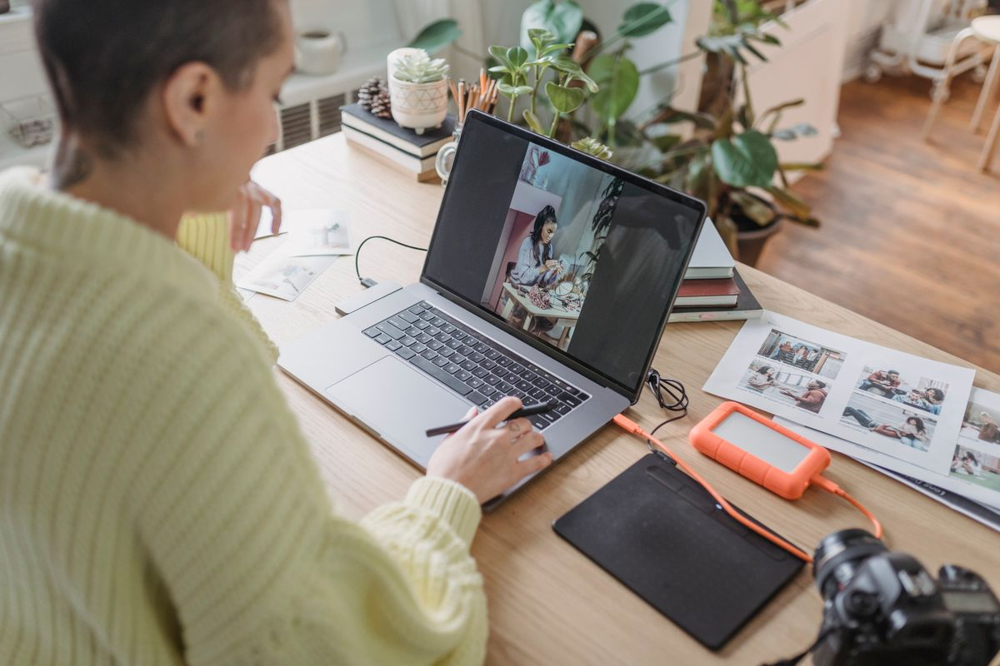

Conteúdo para corretor de imóveis que gera autoridade é aquele que mostra que você conhece imóveis, conhece a região e sabe conduzir uma compra, e não só o que está à venda. Na prática, isso significa alternar seis pilares: imóveis apresentados com opinião, guia do bairro, educação do comprador, bastidores da rotina, prova social real e conteúdo para proprietários. Com um calendário semanal simples e cada gravação reaproveitada em vários formatos, dá para manter a constância sem deixar de atender.

Este guia trata do que postar no Instagram e de como organizar a rotina. A parte técnica de gravar e editar está no guia de [como fazer vídeo de imóvel](/blog/como-fazer-video-de-imovel/).

*Foto: [ANTONI SHKRABA production](https://www.pexels.com/@anthonyshkraba-production) / [Pexels](https://www.pexels.com/photo/woman-recording-herself-with-the-phone-8791261/)*

## Por que só postar imóvel não gera autoridade

Perfil que só mostra imóvel vira catálogo. Funciona para quem procura exatamente aquele imóvel naquela semana, que é uma parte pequena de quem segue você. Os outros não têm motivo para continuar acompanhando.

Autoridade é ser lembrado quando a pessoa decidir comprar ou vender, às vezes meses depois. Marketing pessoal para corretor de imóveis é justamente isso. Para chegar lá, o seguidor precisa aprender algo com você, reconhecer o seu rosto e confiar no seu jeito de trabalhar. E não é só o comprador que assiste: o proprietário que pensa em vender também está olhando e escolhe o corretor que parece entender do assunto.

## Os seis pilares de conteúdo do corretor

### 1. Imóveis, com opinião

Tour apresentado por você, comparativos entre dois imóveis parecidos, o que observar numa visita. A diferença para o catálogo é a sua leitura: para quem o imóvel serve, o que tem de melhor e o que pede atenção.

### 2. Região e bairro

Guia local: escolas, comércio, praças, trânsito no horário de pico, ruas mais tranquilas. Quem pensa em se mudar para o bairro procura exatamente isso, e você passa a ser a referência da região onde atua.

### 3. Educação do comprador

Passo a passo do financiamento, documentos que comprador e vendedor precisam separar e custos além do preço do imóvel, como o imposto de transmissão cobrado pela prefeitura e as despesas de cartório, como escritura e registro, quando for o caso. Explique o processo de forma geral e oriente: os valores variam por cidade, então confirme na prefeitura e no cartório. Esse cuidado também é autoridade.

### 4. Bastidores e rotina

A preparação de uma visita, uma captação, a conferência do imóvel antes do anúncio, o plantão de fim de semana. Mostra que existe trabalho por trás da venda e humaniza o perfil. Só não exponha dados de clientes nem o endereço de um imóvel sem autorização.

### 5. Prova social real

Entrega de chaves, depoimento de quem comprou ou vendeu com você, uma mensagem de agradecimento. Só com autorização do cliente e só o que aconteceu de verdade. Prova social inventada ou exagerada destrói em um dia a confiança que levou meses para construir.

### 6. Conteúdo para proprietários

Como você prepara e divulga um imóvel, o que costuma atrasar uma venda, por que fotos e vídeo bem feitos importam, o que é a autorização de venda. É o pilar que traz captação. As estratégias para conseguir imóveis estão no guia de [como captar imóveis](/blog/como-captar-imoveis/).

## Ideias de posts por pilar

Uma lista para não travar na hora de criar:

**Imóveis**

- Tour curto com o melhor ambiente logo no começo
- O que eu observaria nesta casa antes de fazer uma proposta
- Comparativo de dois imóveis na mesma faixa de preço
- Antes e depois de um imóvel preparado para as fotos

**Região**

- Um dia no bairro: padaria, praça, escola e transporte
- Ruas que você indicaria para quem tem filhos pequenos
- Comparativo entre dois bairros vizinhos
- O que mudou na região: obras, comércio novo, linhas de ônibus

**Educação do comprador**

- Passo a passo do financiamento, do pedido de crédito à assinatura
- Documentos para separar antes de comprar
- Custos além do preço do imóvel, com o aviso para conferir os valores
- Perguntas que todo comprador deveria fazer na visita

**Bastidores**

- Como você prepara uma visita
- Um dia de trabalho contado nos stories
- O que você confere antes de anunciar um imóvel

**Prova social, com autorização**

- Entrega de chaves
- Depoimento curto do cliente em vídeo
- A história de uma venda contada por você, sem dados pessoais

**Proprietários**

- Como eu divulgo um imóvel, do preparo ao anúncio
- Erros que atrasam a venda
- Como comparar o preço com imóveis parecidos da região

## Calendário semanal viável

Um modelo para adaptar à sua agenda:

| Dia | Pilar | Formato | Exemplo |
| --- | --- | --- | --- |
| Segunda | Educação do comprador | Carrossel | Documentos para separar antes de comprar |
| Terça | Imóvel | Reels | Tour apresentado por você |
| Quarta | Bastidores | Stories | Preparação de uma visita |
| Quinta | Região | Reels | Um dia no bairro |
| Sexta | Proprietários ou prova social | Carrossel ou Reels | Como você divulga um imóvel |
| Fim de semana | Relacionamento | Stories | Caixinha de perguntas e visitas do dia |

Se três posts no feed por semana for demais, comece com dois e mantenha os stories. Pior do que postar pouco é postar muito por duas semanas e sumir. Reserve um bloco fixo na semana, por exemplo uma manhã, para planejar e gravar. Assim o conteúdo não depende de sobrar tempo.

## Formatos: Reels, carrossel e stories

Cada formato cumpre um papel diferente:

- **Reels:** costumam chegar também a quem ainda não segue você. Bons para tours, região e dicas rápidas.
- **Carrossel:** conteúdo para salvar e consultar depois. Bom para passo a passo, checklists e comparativos.
- **Stories:** relacionamento com quem já segue. Bons para bastidores, enquetes e caixinha de perguntas.

### Uma gravação, várias peças

Gravar todo dia não cabe na agenda de quem atende. O caminho é gravar em lote e desdobrar cada gravação em várias publicações.

*Foto: [George Milton](https://www.pexels.com/@george-milton) / [Pexels](https://www.pexels.com/photo/unrecognizable-photographer-working-on-laptop-7014919/)*

Exemplo com a visita gravada a um apartamento:

- Reels com o tour completo apresentado por você
- Reels curto só com o destaque, como a varanda ou a cozinha
- Carrossel com fotos e as informações principais
- Stories com os bastidores da gravação
- Versão curta para enviar no WhatsApp a clientes com aquele perfil
- Criativo para anúncio, se o imóvel for impulsionado

O mesmo vale para uma conversa sobre o bairro: alguns minutos falando com o celular no tripé rendem vários vídeos curtos, um por assunto. Imobiliárias locais usam essa lógica para virar referência na região, como mostramos em [vídeo de bairro para imobiliária](/solucoes/video-imobiliario-para-imobiliaria-de-bairro/).

## Perfil: bio, destaques e feed

**Bio.** Nome, corretor de imóveis, a região onde atua, o tipo de imóvel em que trabalha, o número do CRECI e um link para o WhatsApp. Quem chega ao perfil precisa entender em poucos segundos o que você faz e onde.

**Destaques.** Organize por assunto: imóveis disponíveis, bairros, financiamento, clientes (com autorização), quem sou e para proprietários.

**Feed.** Fixe no topo um post de apresentação, o melhor imóvel disponível e o conteúdo educativo mais útil. Use capas legíveis e com o mesmo padrão visual, para o perfil não parecer uma colagem.

## CRECI e autorizações

- **CRECI na publicidade.** As normas do sistema COFECI/CRECI pedem o número do CRECI na publicidade. Coloque na bio e em todo post ou anúncio de imóvel. Confirme com o CRECI da sua região como isso se aplica ao seu caso.
- **Autorização para anunciar.** As mesmas normas pedem autorização do proprietário por escrito para anunciar o imóvel. Confirme os detalhes com o CRECI da sua região.
- **Autorização para filmar.** Combine com o proprietário ou o morador o que pode aparecer e tire da vista fotos de família, documentos e objetos pessoais.
- **Imagem de pessoas.** Cliente, porteiro, vizinho: quem aparece de forma identificável precisa autorizar. Na dúvida, enquadre sem o rosto ou corte na edição.

## Erros que travam o perfil do corretor

- **Só postar imóvel.** O perfil vira catálogo e o seguidor não tem motivo para ficar.
- **Copiar tendência sem relação com o seu trabalho.** Traz visualização de quem nunca vai comprar nem vender com você.
- **Sumir por semanas.** Quem some é esquecido, e recomeçar custa mais do que manter.
- **Prometer valorização.** Frases como "vai valorizar muito" ou "retorno garantido" criam uma expectativa que você não controla e que pode virar reclamação depois. Fale do que é concreto: localização, infraestrutura, o que existe hoje.
- **Inventar números ou depoimentos.** Basta um cliente perceber o exagero para a confiança ir embora.
- **Responder tarde.** Conteúdo bom gera mensagem. Se a resposta demora, o contato procura outro corretor.

## Constância com apoio

Conteúdo de autoridade é rotina, não inspiração. Se você quer produzir sozinho, o curso Corretor de Autoridade, da Fast Up, tem módulos de roteiro e gravação com celular, edição de vídeos imobiliários, IA para corretores (posts, legendas e calendário de conteúdo) e tráfego pago para corretores, além de templates de roteiros e checklists. Se prefere delegar a produção, a Fast Up faz [vídeo para corretor autônomo](/solucoes/video-imobiliario-para-corretor-autonomo/), com linha editorial, gravação em lote e edição com a sua identidade visual, para você continuar fazendo o que só você faz: atender e vender.
