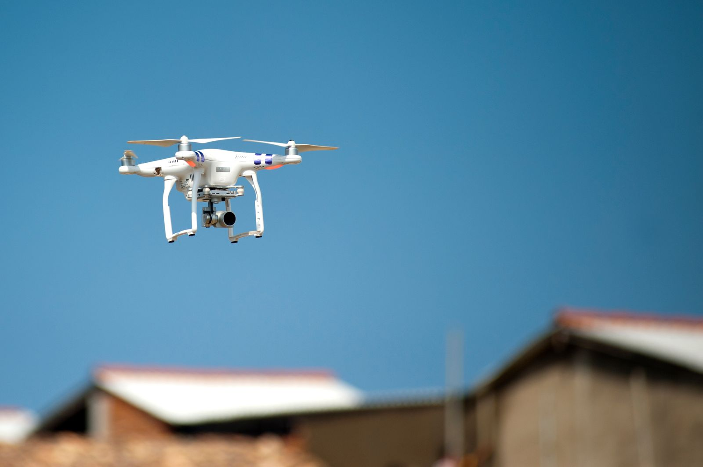
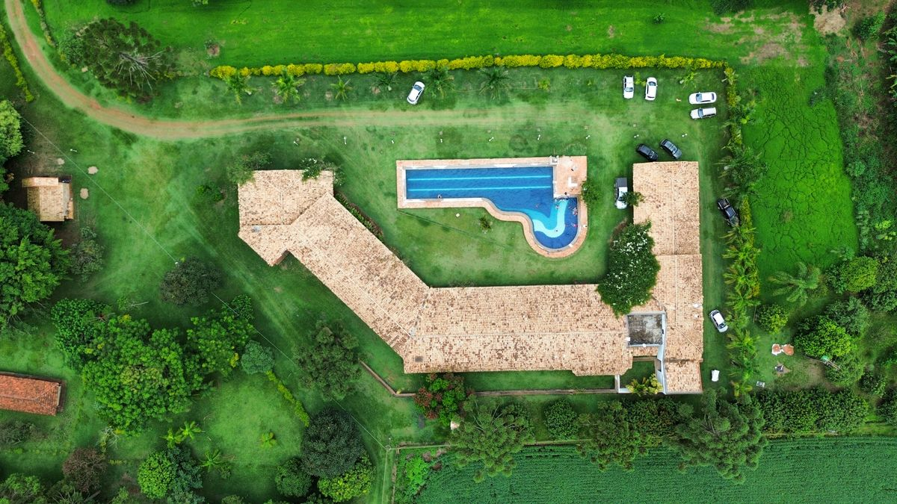

Vídeo de imóvel com drone vale a pena quando a localização, o terreno ou a vista fazem parte do que está sendo vendido: loteamentos, imóveis rurais, casas em condomínio, casas com terreno grande, imóveis com vista ou perto da praia, lançamentos e alto padrão. Nesses casos, poucos segundos de imagem aérea mostram o que nenhuma tomada no chão consegue. Em apartamento sem vista numa região adensada, o drone acrescenta pouco. E mesmo quando compensa, ele funciona melhor no gancho e no contexto do vídeo, não como o vídeo inteiro.

Este guia trata só da parte aérea: quando usar, o que mostrar, quais tomadas pedir e como contratar o piloto. Roteiro, gravação e edição do tour interno estão no guia de [como fazer vídeo de imóvel](/blog/como-fazer-video-de-imovel/).

*Foto: [Atlantic Ambience](https://www.pexels.com/@freestockpro) / [Pexels](https://www.pexels.com/photo/selective-focus-photograph-of-white-quadcopter-drone-during-blue-hour-319968/)*

## Quando o drone vale a pena

A pergunta certa não é se o drone deixa o vídeo mais bonito. Quase sempre deixa. A pergunta é: o comprador precisa ver o imóvel de cima para entender o que está comprando? Quando a resposta é sim, as imagens aéreas de imóveis deixam de ser enfeite e passam a vender.

| Tipo de imóvel | O que a imagem aérea mostra |
| --- | --- |
| Loteamento | Tamanho do empreendimento, ruas, portaria, áreas verdes e acesso à rodovia ou à cidade |
| Imóvel rural | Extensão da área, água, mata, pasto, sede, benfeitorias e estrada de acesso |
| Casa em condomínio | A casa dentro do condomínio, o lazer, as áreas verdes e a portaria |
| Casa com terreno grande | Quintal, piscina, pomar e espaço livre em volta da construção |
| Imóvel com vista ou perto da praia | A distância real até o mar, a orla e a paisagem em volta |
| Lançamento | O terreno, o entorno e os acessos, enquanto o prédio ainda não existe |
| Alto padrão | A implantação da casa, o paisagismo e a privacidade do lote |

Em comum, todos têm algo que o comprador só entende olhando de cima: tamanho, posição ou vizinhança. Para quem mora em outra cidade, isso pesa ainda mais.

## Quando o drone não compensa

Em alguns casos, o dinheiro rende mais num tour interno bem feito:

- **Apartamento sem vista em área adensada.** De cima, aparecem telhados e prédios parecidos. O comprador quer ver a planta, a luz e o acabamento.
- **Entorno que é ponto fraco.** Avenida barulhenta, terreno abandonado ao lado, fiação pesada. O drone destaca exatamente isso. Não é para esconder, porque o comprador vai ver na visita, mas não faz sentido gastar o gancho mostrando o problema.
- **Imóvel cujo trunfo está dentro.** Reforma recente, cozinha planejada, boa decoração. A câmera precisa estar nos ambientes.
- **Área com restrição de voo.** Algumas regiões, como as proximidades de aeroportos, têm restrições ou exigem autorização específica.

Se o orçamento é curto, priorize o tour interno. O drone complementa, não substitui.

## O que mostrar nas imagens aéreas

Antes da filmagem aérea, defina com o piloto o que cada tomada precisa mostrar ao comprador. Voar sem roteiro gera minutos de imagem bonita que não respondem nenhuma dúvida de quem está decidindo.

*Foto: [Clodoaldo Franco](https://www.pexels.com/@clodoaldo-franco-2150764283) / [Pexels](https://www.pexels.com/photo/aerial-view-of-countryside-estate-with-pool-31316043/)*

### Localização relativa e acessos

Mostre onde o imóvel fica em relação ao que importa: a praia, o centro, a rodovia, o parque, a escola. Na edição, nomeie essas referências com texto na tela. Só fale em tempo de deslocamento se você tiver conferido o trajeto.

### Terreno e divisas aproximadas

Uma linha desenhada sobre a imagem ajuda o comprador a entender o formato e o tamanho do terreno. Mas é uma referência visual, não uma medição. Escreva "divisas aproximadas" na tela e nunca afirme no vídeo que aquelas são as divisas exatas. Área, medidas e confrontações estão na documentação do imóvel, como a matrícula, a planta e o levantamento topográfico, quando houver. É ela que vale na negociação.

### Vista

Se a vista é o diferencial, mostre a paisagem que o morador vai ter, sem exagero. Num apartamento, a tomada aérea só é honesta se mostrar a vista na altura e na direção da unidade anunciada. Mostrar a vista de um andar mais alto é vender uma expectativa que a visita vai desmentir.

### Entorno e infraestrutura

Ruas asfaltadas, iluminação, portaria, áreas verdes, comércio próximo. Em loteamentos e lançamentos, deixe claro o que já está pronto e o que ainda está em obra. Imagem aérea que sugere uma infraestrutura inexistente vira reclamação depois.

## Tomadas que funcionam em vídeo de imóvel

Quatro movimentos resolvem a maioria dos vídeos. Peça cada um pelo nome:

| Tomada | Como é | Para que serve |
| --- | --- | --- |
| Subida revelando | Começa baixo, perto da fachada, e sobe devagar abrindo o quadro | Gancho: revela o imóvel e o terreno de uma vez |
| Órbita | Circula o imóvel mantendo a casa no centro | Mostra todos os lados e o quintal |
| Avanço até o imóvel | Começa longe, na paisagem, e se aproxima até a entrada | Liga a localização ao imóvel |
| Transição do aéreo para o interno | O voo termina na porta e o corte segue com a câmera de mão entrando | Costura o aéreo com o tour |

Uma quinta tomada útil é a vista de cima, com a câmera apontada para baixo. Ela mostra a implantação, o formato do lote e a piscina, e funciona muito bem em loteamentos.

Peça movimentos lentos e contínuos, com alguns segundos parados no início e no fim de cada tomada, para dar folga à edição.

## Drone no gancho e no contexto, não no vídeo inteiro

Um erro comum é entregar um vídeo só de imagens aéreas. Ele impressiona nos primeiros segundos e depois cansa, porque o comprador quer saber como é por dentro. Pense assim: o aéreo responde onde fica e o que tem em volta, e o tour interno responde como é viver ali.

Uma estrutura que funciona bem em vídeo curto:

1. **Gancho aéreo:** subida revelando a casa e o terreno, ou avanço com o mar ao fundo.
2. **Contexto:** órbita ou avanço curto mostrando acessos e entorno.
3. **Transição:** o voo termina na entrada.
4. **Tour interno:** os ambientes na ordem de uma visita.
5. **Área externa:** volta rápida ao aéreo para mostrar piscina, quintal ou terreno.
6. **Informações e chamada:** dados principais e convite para agendar a visita.

Combine com o piloto se o vídeo vai para Reels e anúncios. Algumas tomadas precisam ser pensadas para o formato vertical: gravadas já na vertical, quando o equipamento permite, ou com resolução que aguente o recorte sem perder qualidade.

Nos anúncios, vale testar duas aberturas: uma com o aéreo e outra com o melhor ambiente interno. Compare qual traz mais contatos que agendam visita, não só mais cliques. O guia de [tráfego pago para imobiliárias](/blog/trafego-pago-para-imobiliarias/) explica como medir isso.

## Regras, privacidade, clima e horário

### Regras de voo

O uso de drones no Brasil tem regras de cadastro e de voo definidas por órgãos como a ANAC, o DECEA e a Anatel. Elas mudam conforme o equipamento, o tipo de uso e o local, e são atualizadas de tempos em tempos. Por isso, não confie em regra repassada de boca em boca. O caminho seguro é contratar um piloto habilitado, que já trabalha dentro dessas exigências, ou conferir as regras vigentes nos canais oficiais desses órgãos antes de voar.

### Privacidade dos vizinhos

O drone enxerga por cima do muro. Evite enquadrar de perto quintais, janelas e pessoas da vizinhança. Na edição, corte ou desfoque o que identificar alguém. Em condomínio, avise a administração antes e confira se há regras internas para voo. E tenha a autorização do proprietário para gravar o imóvel.

### Seguro

Imprevistos acontecem: uma rajada de vento, uma bateria que falha. Pergunte ao piloto se ele tem seguro que cubra danos a terceiros e como fica a responsabilidade se algo der errado durante o voo.

### Clima e horário

Vento forte deixa a imagem instável e pode impedir o voo. Chuva impede. Céu muito fechado apaga as cores. O começo da manhã e o fim da tarde dão tons mais quentes e sombras que valorizam o relevo, e o sol alto funciona para a vista de cima. Veja para onde a fachada está virada, para não gravar a casa contra o sol, e marque a data com margem para remarcar.

## Drone para corretor de imóveis: comprar ou contratar?

Muitos corretores pensam em comprar o próprio drone. Pode fazer sentido para quem trabalha toda semana com imóveis rurais, loteamentos ou casas com terreno grande. Mas o equipamento é a parte menor: pilotar bem exige prática, as regras de cadastro e de voo valem para você também, e um acidente sem seguro sai caro. Para uso eventual, contratar um piloto habilitado costuma ser mais simples. Se decidir comprar, estude as regras atuais antes do primeiro voo.

## Checklist para contratar um piloto de drone

Antes de fechar, faça estas perguntas:

- Você e o equipamento estão cadastrados conforme as regras atuais? Pode mostrar os comprovantes?
- Tem seguro que cubra danos a terceiros?
- Já verificou se a área do imóvel tem restrição de voo? Se precisar de autorização para aquele local, quem pede?
- Quais tomadas estão incluídas? Faz subida, órbita, avanço e vista de cima?
- Grava na vertical ou com resolução que permita recortar para Reels?
- Em que formato e resolução entrega os arquivos? Entrega o material bruto, sem edição, para quem vai montar o vídeo?
- Qual é o prazo de entrega?
- O que acontece se o dia amanhecer com vento ou chuva?
- Em quais canais e por quanto tempo posso usar as imagens, inclusive em anúncios pagos?

## Como a Fast Up trabalha com imagens aéreas

A Fast Up não voa drone. Cuidamos do roteiro, da captação em solo e da edição do vídeo. Quando o imóvel tem imagens aéreas, feitas por um piloto habilitado, elas entram na edição junto com o tour interno, e o roteiro já prevê onde cada tomada aparece: no gancho, no contexto e na transição para dentro do imóvel. Esse cuidado pesa mais em [vídeo para loteamento](/solucoes/video-imobiliario-para-loteamentos/) e em [vídeo de imóvel rural](/solucoes/video-imobiliario-para-imoveis-rurais/), em que o terreno e o entorno são boa parte da venda.
