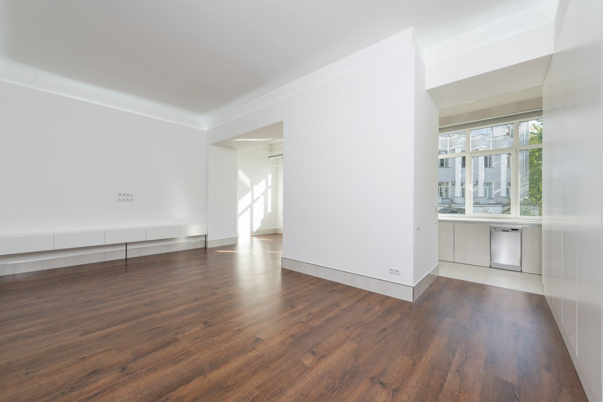

## Estoque pronto pede outra campanha, não a do lançamento

Quando o prédio fica pronto e ainda sobram unidades, muita construtora repete a campanha do lançamento: fachada, lazer, localização. Só que agora o comprador pode ver o apartamento de verdade, e é isso que ele quer. Falar do empreendimento inteiro atrai gente interessada em tipologias que já esgotaram e esconde justamente o que está disponível.

*Foto: [Max Vakhtbovych](https://www.pexels.com/@artbovich) / [Pexels](https://www.pexels.com/photo/white-room-with-wooden-flooring-8146158/)*

A campanha de estoque inverte a lógica. Cada unidade vira um anúncio, com andar, face, planta, vaga e o que ela tem de melhor. O vídeo é da unidade real, gravado na hora em que ela recebe mais luz, com a vista que o comprador vai ter da janela. E a mensagem fala com quem tem pressa: quem paga aluguel, quem vendeu outro imóvel ou quem não quer esperar anos de obra. "Pronto para morar" é um argumento que nenhum lançamento tem.

## Enfrentar o "sobrou porque é pior"

Toda unidade remanescente carrega uma suspeita. O comprador pensa que, se ninguém quis, deve haver um problema. Ignorar essa dúvida não funciona, porque ela aparece na visita. O caminho é mostrar a unidade como ela é e dizer para quem ela é boa. O apartamento do primeiro andar pode servir para quem tem criança pequena ou idoso em casa. A face sem vista pode ser a mais silenciosa. A planta diferente pode ter um ambiente a mais. Só vale quando é verdade, e por isso o levantamento de cada unidade vem antes de qualquer anúncio.

Enquanto isso, a unidade parada segue gerando condomínio e manutenção. A medida de sucesso, então, é por unidade: quantas visitas e propostas cada uma recebeu. Unidade sem visita pede outro ângulo, outro público ou uma conversa com a construtora sobre a condição comercial. Se os contatos chegam mas não avançam, o diagnóstico de [anúncios de imóveis que não geram leads](/blog/anuncios-de-imoveis-que-nao-geram-leads/) ajuda a achar onde está o problema.

## Corretores parceiros com o mesmo material

Muitas construtoras vendem o estoque também por imobiliárias parceiras. Se cada corretor apresenta a unidade de um jeito, o comprador recebe informações desencontradas. Por isso o vídeo, a ficha e o texto de cada unidade vão também para os parceiros, e os contatos dos anúncios chegam com a origem registrada. O guia de [funil de vendas imobiliário](/blog/funil-de-vendas-imobiliario/) mostra como acompanhar cada contato até a proposta.
