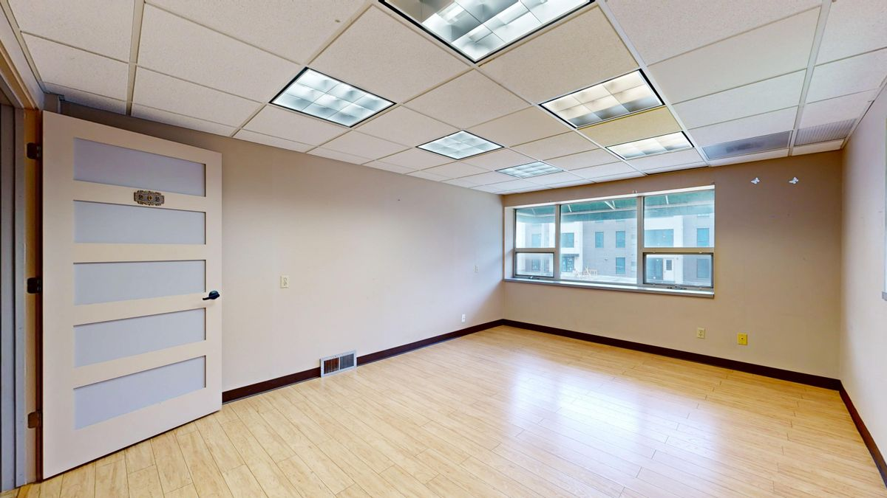

## Imóvel comercial é decisão técnica

Quem procura sala, loja ou galpão não está escolhendo onde morar. É um empresário, um profissional liberal ou um investidor, muitas vezes com sócios, avaliando se o espaço comporta a operação. As perguntas são diretas: quantos metros, qual o pé-direito, qual a carga de energia, quantas vagas, se o caminhão entra, quantas pessoas passam na frente.

*Foto: [Peter Vang](https://www.pexels.com/@peter-vang-2157328093) / [Pexels](https://www.pexels.com/photo/spacious-modern-office-with-natural-light-35539060/)*

Isso muda o anúncio. A emoção do imóvel residencial dá lugar à informação. Um vídeo que mostra a fachada, a porta de carga e o quadro de energia convence mais do que uma trilha bonita. E como as opções do Meta para segmentar por profissão ou cargo são limitadas, é o próprio anúncio que separa quem precisa daquele espaço de quem só está olhando.

## Uma campanha para cada tipo de imóvel

Sala, loja e galpão atraem públicos que não têm nada em comum, por isso cada um ganha campanha própria:

- **Salas:** profissionais liberais e escritórios. Pesam localização, vagas, estrutura do prédio e acesso de clientes.
- **Lojas:** varejo e serviços. Pesam fachada, visibilidade e fluxo de pessoas na rua.
- **Galpões:** indústria, logística e distribuição. Pesam pé-direito, piso, energia, docas e acesso para carretas.

Venda e locação também se separam. Quem vai ocupar quer valor mensal e prazo para entrar. Quem compra para alugar quer saber de ocupação e documentação, e o anúncio não promete renda.

## Poucos contatos, atendimento à altura

No comercial, o volume de contatos é baixo e cada um vale muito. O atendimento começa com perguntas de empresa: qual a atividade, a metragem mínima, a necessidade de carga, o prazo de mudança. E traz um aviso que evita negócio perdido: o uso permitido para aquela atividade precisa ser confirmado na prefeitura antes da proposta.

Parte das empresas também procura no Google, principalmente quando o assunto é galpão. O post sobre [Google Ads para imóveis](/blog/google-ads-para-imoveis/) mostra quando vale complementar o Meta Ads, e o guia de [qualificação de leads imobiliários](/blog/qualificacao-de-leads-imobiliarios/) traz as perguntas para separar quem tem perfil.
