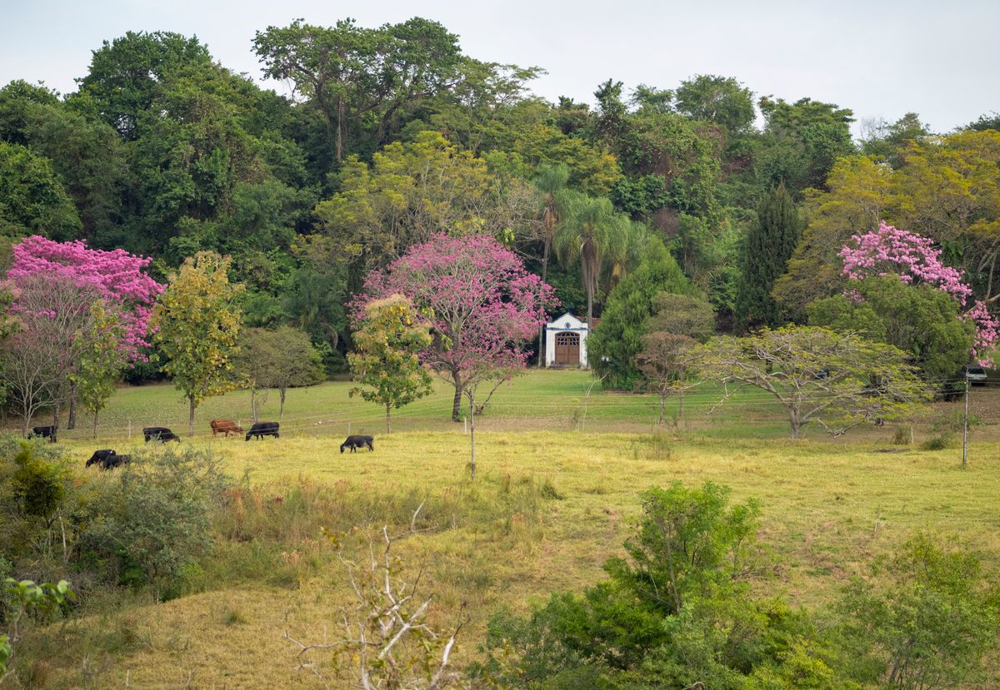

## Imóvel rural não tem um comprador só

Chácara, sítio e fazenda atraem gente com objetivos muito diferentes. O morador da cidade quer um lugar para o fim de semana, com casa pronta, piscina e pomar. O produtor rural quer saber de solo, água, pasto e estrutura de trabalho. O investidor olha área, localização e documentação. Cada perfil para no feed por um motivo, então cada um ganha anúncio próprio.

*Foto: [André Ulysses De Salis](https://www.pexels.com/@andre-ulysses-de-salis-2100065) / [Pexels](https://www.pexels.com/photo/cattle-farm-with-flowering-trees-and-green-grass-8290728/)*

O que todos perguntam é parecido: como é o acesso, se a estrada aguenta a época de chuva, de onde vem a água (nascente, poço ou rio), quais são as benfeitorias e como é o relevo. Quando essas respostas estão no vídeo e no texto, o anúncio já faz a primeira triagem.

## Mostrar a propriedade inteira, de longe e de perto

O criativo de imóvel rural precisa dar noção de escala. O vídeo começa na estrada de acesso, passa pela sede e pelas benfeitorias, mostra a água e termina com uma visão do conjunto. Quando houver imagens aéreas, feitas por um piloto habilitado, elas mostram área e limites como nenhuma imagem do chão consegue. O post sobre [vídeo de imóvel com drone](/blog/video-de-imovel-com-drone/) explica quando vale a pena.

A região da campanha também foge do padrão. Muitos compradores de lazer moram em cidades grandes, longe da propriedade, então a segmentação inclui essas cidades e não só o entorno do imóvel. O anúncio deixa claro onde fica a área e quanto tempo leva para chegar.

## Filtrar antes de pegar a estrada

Uma visita rural toma o dia do corretor e do comprador. Por isso, a conversa no WhatsApp faz o trabalho pesado antes: envia o vídeo completo, confirma o uso pretendido, a forma de pagamento e a disponibilidade para viajar. Dúvidas sobre documentos como CCIR, ITR e CAR pedem resposta segura, então confirme com um especialista antes de afirmar qualquer coisa. O guia de [como responder lead imobiliário no WhatsApp](/blog/como-responder-lead-imobiliario-no-whatsapp/) traz modelos para esse primeiro contato.
