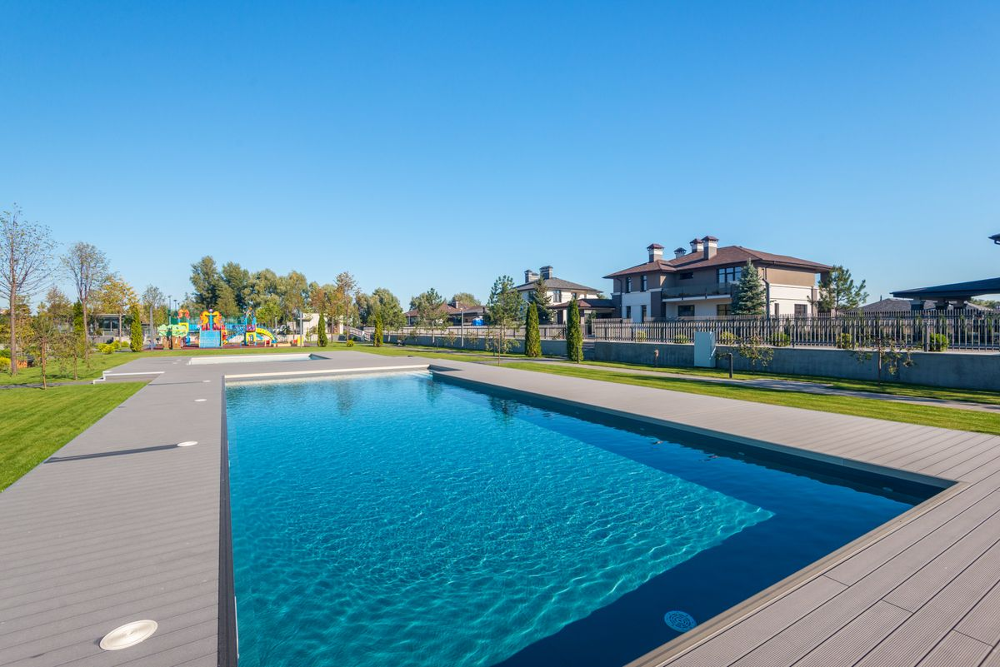

## Em condomínio, a casa vem com o lugar

Quem procura casa em condomínio fechado quase sempre já decidiu o tipo de vida que quer: portaria controlada, ruas tranquilas, lazer perto de casa, vizinhança parecida. A casa é a segunda pergunta. Um vídeo que mostra só os cômodos responde metade do que esse comprador quer saber.

Por isso, a produção trabalha em duas camadas. A primeira é o condomínio: portaria, ruas internas, áreas verdes, quadras, piscina e salão. A segunda é a casa: o tour de cada imóvel, com os trechos do condomínio que fazem sentido para ele.

## Gravar o condomínio uma vez, usar em todas as casas

O condomínio é gravado uma vez, com autorização da administração, e vira um banco de trechos. A cada nova casa no mesmo condomínio, a equipe grava só o imóvel e reaproveita portaria, ruas e lazer. O padrão visual se repete, e quem vê duas casas do mesmo lugar reconhece o condomínio na hora.

*Foto: [Max Vakhtbovych](https://www.pexels.com/@artbovich) / [Pexels](https://www.pexels.com/photo/clear-sky-over-swimming-pool-7546708/)*

Para a imobiliária com várias casas no mesmo condomínio, isso muda a conta: menos tempo de gravação por imóvel e um único pedido de autorização para as áreas comuns. Quando houver imagens aéreas, feitas por um piloto habilitado e com o aval da administração, elas mostram a escala e o verde do condomínio. Veja quando elas compensam no guia de [vídeo de imóvel com drone](/blog/video-de-imovel-com-drone/).

## Rotina, privacidade e segurança

O comprador de condomínio quer sentir o dia a dia. Vale gravar em horários diferentes: a rua de manhã cedo, o lazer no fim da tarde, a iluminação à noite. A rotina aparece sem que ninguém seja identificado. Moradores ficam distantes, de costas ou fora do quadro, e crianças não aparecem reconhecíveis.

A segurança pede o mesmo equilíbrio. O vídeo mostra o que dá tranquilidade, como portaria, controle de acesso e ruas iluminadas, e deixa de fora o que expõe o condomínio, como posição de câmeras, rotina de ronda e o interior da guarita. Combinar esses limites antes com o síndico evita retrabalho e facilita voltar para gravar a próxima casa. Os fundamentos de gravação de cada imóvel estão no guia de [como fazer vídeo de imóvel](/blog/como-fazer-video-de-imovel/).
