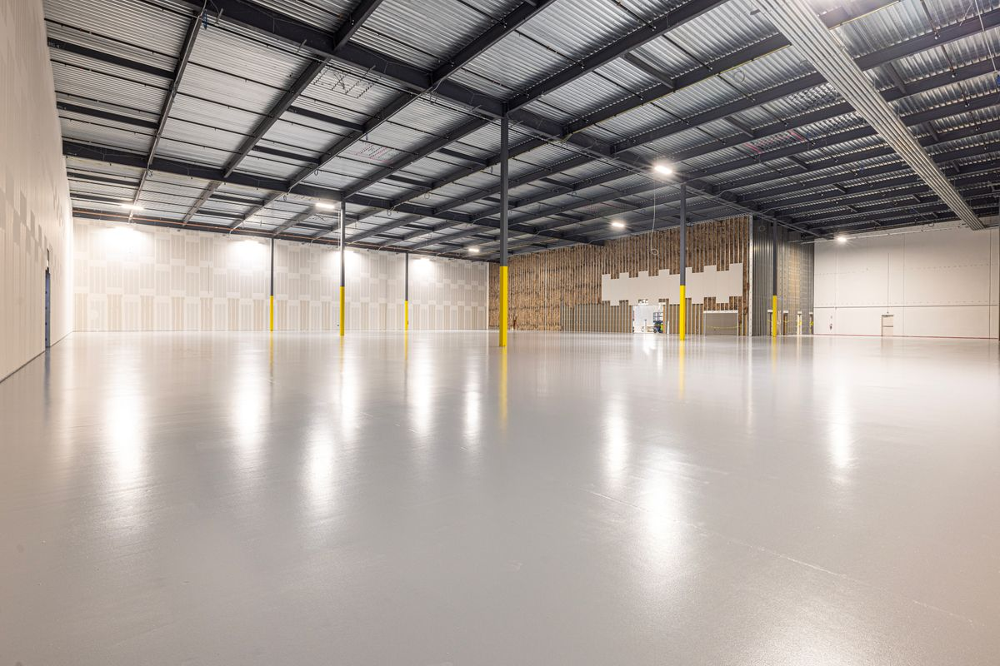

## Empresa decide por informação, não por emoção

No residencial, o vídeo faz o comprador se imaginar morando ali. No comercial, o interessado quer saber se a operação dele cabe no espaço. Ele vai perguntar pé-direito, energia, vagas, banheiros, acesso de carga, valor e condomínio. Se o vídeo não responde, ele liga para perguntar ou passa para o próximo anúncio.

*Foto: [Craftsman Concrete Floors](https://www.pexels.com/@craftsman-concrete-floors-2159674718) / [Pexels](https://www.pexels.com/photo/spacious-modern-warehouse-interior-in-texas-36217325/)*

Por isso, o vídeo comercial tem tom objetivo. Os dados aparecem na tela no momento em que o ambiente é mostrado: a metragem na tomada aberta, o pé-direito junto da imagem do teto, as vagas no estacionamento. A trilha fica baixa e o ritmo é de visita técnica, não de propaganda.

## Fachada, rua e acesso contam tanto quanto o interior

Para lojas, clínicas e escritórios de atendimento, o ponto é metade do negócio. O vídeo começa na rua: a fachada vista de quem passa de carro e a pé, a calçada, o movimento de pessoas e carros no horário em que a empresa vai funcionar. Gravar num domingo de manhã esconde justamente o que o interessado quer avaliar.

Em galpões, a pergunta é outra: o caminhão chega? O vídeo percorre a rua de acesso, a entrada do pátio, a área de manobra e as docas. Quando houver imagens aéreas, feitas por um piloto habilitado, elas mostram o terreno e a posição em relação às vias principais.

## Um vídeo que circula dentro da empresa

Imóvel comercial raramente é decidido por uma pessoa só. Quem viu o anúncio precisa convencer sócios, diretoria ou a matriz. Por isso, além dos cortes curtos para anúncio, entregamos um tour sem cortes para avaliação técnica e uma versão objetiva, com os dados na tela, que o interessado encaminha aos sócios. Quando o espaço está vazio, a edição indica possibilidades de layout, sempre como sugestão.

O objetivo é que a visita presencial aconteça com quem já sabe que o espaço serve. Os fundamentos de gravação estão no guia de [como fazer vídeo de imóvel](/blog/como-fazer-video-de-imovel/), e onde publicar cada versão está em [como anunciar imóveis na internet](/blog/como-anunciar-imoveis-na-internet/).
