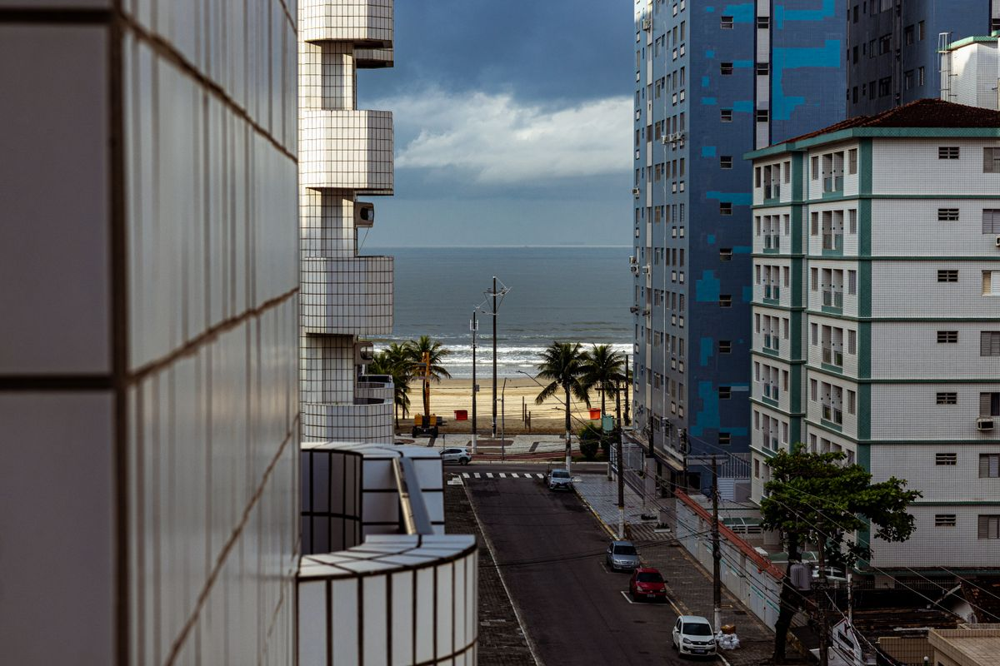

## O vídeo faz o papel da primeira visita

No litoral, é comum o comprador morar longe do imóvel. Ele não passa na frente por acaso nem visita três apartamentos numa tarde. Antes de pegar a estrada, quer ter certeza de que a viagem vale a pena. Por isso, o vídeo de imóvel na praia precisa ser completo, não só bonito.

*Foto: [Juan Pablo Daniel](https://www.pexels.com/@who0ne) / [Pexels](https://www.pexels.com/photo/coastal-cityscape-with-modern-architecture-40271967/)*

Completo quer dizer: todos os ambientes, na ordem de quem entra, sem pular a área de serviço ou o banheiro antigo. O caminho real a pé até a areia, com o tempo de caminhada na tela. A vista como o olho vê, com os prédios vizinhos que estiverem no meio. E o sol: onde ele bate de manhã e à tarde, porque quem vai passar o verão ali costuma perguntar isso logo no primeiro contato.

## Maresia, condomínio e entorno sem filtro

Imóvel na praia sofre com o tempo de um jeito próprio. Ferragens, pintura, esquadrias e portões mostram a ação da maresia. Esconder isso no vídeo só transfere a surpresa para a visita, depois de horas de estrada. Mostrar com boa luz, junto com o que já foi feito de manutenção, passa segurança.

O entorno também faz parte da compra de quem não conhece a cidade: portaria, garagem, lazer do condomínio, mercado, farmácia e serviços por perto. Imagens aéreas ajudam a mostrar a posição do imóvel na orla, quando houver, feitas por um piloto habilitado. Veja quando elas fazem diferença no guia de [vídeo de imóvel com drone](/blog/video-de-imovel-com-drone/).

## Vídeo gravado, chamada ao vivo e versões curtas

O tour completo convence quem já está interessado. Para chegar até esse comprador, a mesma gravação gera cortes curtos para anúncio e redes, com o melhor do imóvel nos primeiros segundos. E quando o interessado tem uma dúvida específica, a chamada de vídeo ao vivo com o corretor completa o que o vídeo gravado não mostrou. Os princípios de roteiro, luz e gravação estão no guia de [como fazer vídeo de imóvel](/blog/como-fazer-video-de-imovel/).
