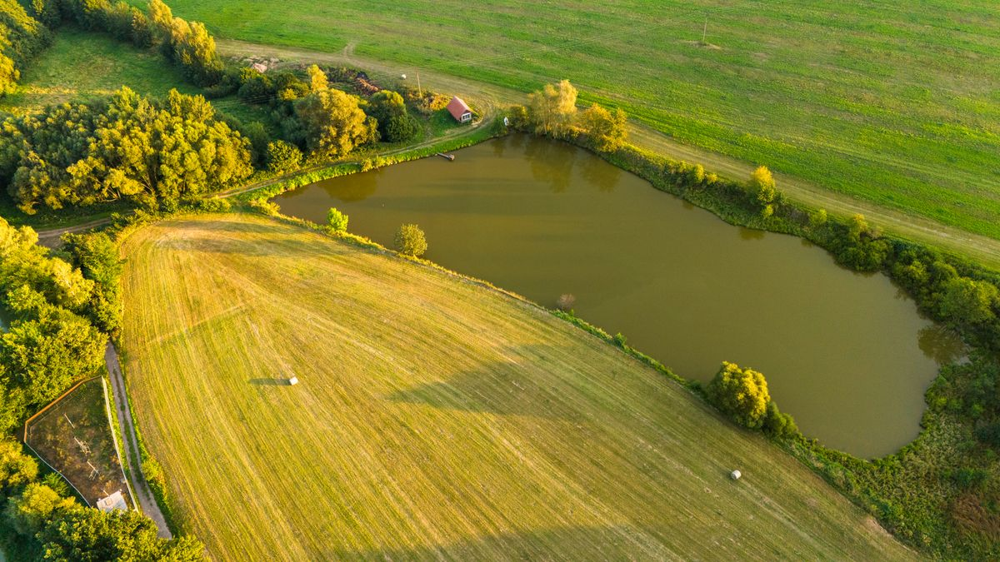

## Quem compra terra decide de longe

Comprador de sítio, chácara ou fazenda muitas vezes mora em outra cidade, às vezes em outro estado. Antes de pegar a estrada, ele quer saber o essencial: como se chega, quanta água tem, em que estado estão as benfeitorias e como é a terra. O vídeo é o que separa uma viagem decidida de uma viagem perdida.

Por isso, o vídeo de imóvel rural é mais longo e mais completo que o de uma casa. Ele percorre a propriedade na ordem em que o comprador vai conhecê-la: a estrada, a porteira, a sede, as benfeitorias, as aguadas, o pasto e as áreas de mata.

## O que mostrar, e como mostrar com honestidade

Água costuma ser a primeira pergunta. Nascente, represa, açude, poço e rio ganham tomadas próprias, com o que o proprietário informa escrito na tela. Casa, galpão, curral e cercas aparecem como estão. O pasto e o solo também: o comprador experiente lê a terra pela imagem.

*Foto: [Stepan Vrany](https://www.pexels.com/@stepan-vrany-591647707) / [Pexels](https://www.pexels.com/photo/aerial-view-of-a-pond-and-a-field-27970736/)*

Dois cuidados evitam problema na negociação:

- **Divisas só como indicação.** Quando houver imagens aéreas, feitas por um piloto habilitado, a edição pode marcar a área de forma aproximada. A referência é sempre a documentação do imóvel, e isso fica escrito na tela.
- **Época do ano declarada.** Pasto de chuva e pasto de seca são paisagens diferentes. O vídeo informa o mês da gravação e, quando há imagens de outra estação, mostra as duas.

O que as imagens aéreas mostram bem e quando valem o investimento está no guia de [vídeo de imóvel com drone](/blog/video-de-imovel-com-drone/).

## Versão longa para quem está decidindo

Os cortes curtos servem para chamar atenção nas redes e nos anúncios. Mas quem já se interessou quer ver tudo, com calma, e mostrar para a família ou o sócio. Para esse comprador, entregamos uma versão longa, que percorre a propriedade quase como uma visita, com o trajeto da estrada gravado de verdade. Os fundamentos de luz, movimento e roteiro estão no guia de [como fazer vídeo de imóvel](/blog/como-fazer-video-de-imovel/).
