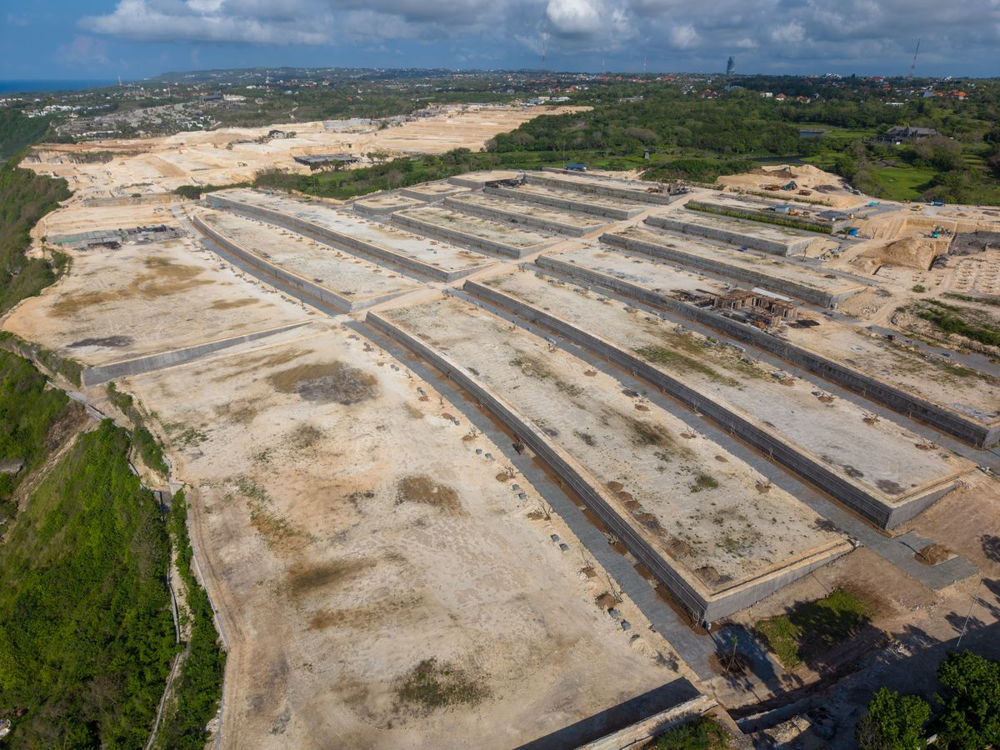

## Loteamento se vende pelo lugar, não pelo lote

Quem compra lote está comprando um lugar que ainda vai existir: a casa que pretende construir, a rua onde os filhos vão brincar, o caminho até o trabalho. O lote em si é terra. Por isso, o vídeo de loteamento não pode ser um passeio solto por um terreno vazio. Ele precisa responder, na ordem, o que o comprador quer saber: como se chega, o que já está pronto, onde fica o lote e quanto tempo leva até a cidade.

*Foto: [Tom Fisk](https://www.pexels.com/@tomfisk) / [Pexels](https://www.pexels.com/photo/aerial-view-of-construction-site-in-bali-indonesia-36422828/)*

O vídeo começa no acesso e segue como uma visita: portaria, avenida principal, ruas, área verde, lazer e, por fim, as quadras à venda. A infraestrutura ganha tomadas próprias. Asfalto, meio-fio, postes, iluminação e pontos de água são o que o comprador paga além da terra. O que ainda está em obra também aparece, com o estágio escrito na tela. Esconder uma rua sem asfalto só adia a pergunta para a visita.

## Mapa, trajeto e ilustração no lugar certo

Três recursos de edição fazem diferença no loteamento:

- **Mapa de lotes na tela.** O comprador entende tamanho, posição e vizinhança do lote. Quando há imagens aéreas, feitas por um piloto habilitado, a quadra em destaque recebe uma marcação aproximada. A referência continua sendo o mapa aprovado.
- **Trajeto gravado.** Em vez de escrever perto do centro, mostramos o caminho de carro e registramos o tempo daquele percurso. O comprador confere com os próprios olhos.
- **Perspectivas identificadas.** Ilustrações de casas ajudam a imaginar o bairro pronto, mas entram com a indicação de imagem ilustrativa.

Quando as imagens aéreas valem o investimento e o que elas mostram melhor está no guia de [vídeo de imóvel com drone](/blog/video-de-imovel-com-drone/).

## Um material para cada canal de venda

O loteamento costuma ser vendido por muitas mãos: anúncios, corretores parceiros e plantão. Por isso, a mesma captação vira versões diferentes. O vertical curto vai para os anúncios. O kit padronizado vai para os parceiros, com as mesmas informações para todos. As versões leves ficam com o plantão, para enviar no WhatsApp a quem pediu detalhes ou vai visitar no fim de semana.

Durante as obras de infraestrutura, cada etapa concluída rende um vídeo curto: a rua que recebeu asfalto, a iluminação ligada, a portaria pronta. Quem já comprou acompanha, e quem ainda decide vê o loteamento andar. Para levar esses vídeos aos compradores certos, veja como funciona o [tráfego pago para loteamentos](/solucoes/trafego-pago-para-loteamentos/).
