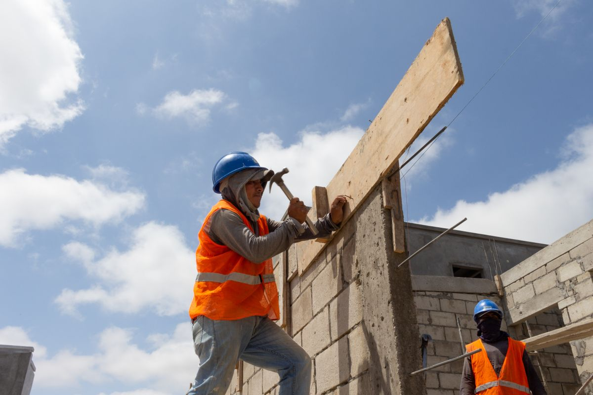

## Dois públicos assistem ao mesmo vídeo

O vídeo de lançamento ajuda o comprador a imaginar um prédio que ainda não existe. O vídeo de acompanhamento de obra tem outro trabalho: provar, a cada atualização, que o prédio está saindo do papel. E ele fala com dois públicos ao mesmo tempo.

*Foto: [Malú Pérez](https://www.pexels.com/@malu-perez-609616616) / [Pexels](https://www.pexels.com/photo/men-on-a-construction-field-19643543/)*

Quem já comprou quer saber se o dinheiro está virando parede. Sem notícia, a ansiedade vira ligação, mensagem e reclamação para a equipe de relacionamento. Quem ainda está decidindo quer prova de que a obra anda. Por isso, o mesmo material sai em duas versões: uma mais completa para os clientes e cortes curtos para redes e anúncios. Esse contato depois da assinatura é o pós-venda, etapa que fecha o [funil de vendas imobiliário](/blog/funil-de-vendas-imobiliario/) e que também precisa de conteúdo. Pré-lançamento, decorado e stand ficam na página de [vídeo para lançamento na planta](/solucoes/video-imobiliario-para-lancamentos-na-planta/).

## Ritmo fixo e marcos da obra

O que gera confiança é a regularidade. Um dia fixo de gravação, por exemplo uma vez por mês, faz o comprador saber quando esperar a próxima novidade. Entre as atualizações de rotina, os marcos ganham vídeo próprio: fundação, estrutura, fechamento da fachada, início do acabamento. São os momentos que o comprador vai querer mostrar para a família.

Quando a incorporadora tem câmera de time-lapse ou imagens aéreas feitas por piloto habilitado, elas entram na edição e mostram o tamanho da obra. O guia de [vídeo de imóvel com drone](/blog/video-de-imovel-com-drone/) explica o que pedir nessas imagens.

## Segurança no canteiro e informação aprovada

Canteiro de obra não é estúdio. A equipe grava com equipamento de proteção, só nos locais liberados e acompanhada por alguém indicado pela engenharia. O horário é combinado para não atrapalhar o trabalho.

O cuidado com a informação é o mesmo. Porcentagem concluída, etapas e prazos entram no vídeo só depois de aprovados pela engenharia, e o vídeo não promete data de entrega. Se o cronograma precisar de ajuste, o tom é honesto: o que mudou, o que está sendo feito e quando sai a próxima atualização. Esconder o ajuste não apaga a dúvida, só adia a cobrança.
